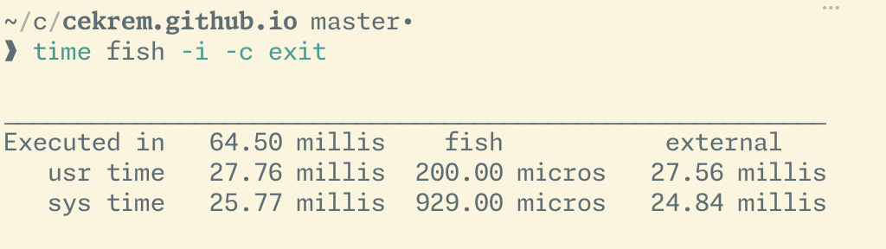

+++
date = 2026-11-04
title = "New Season Upgrades Vol 4: Fish, Ghostty and Way Too Many Fonts"
description = "New shell, new terminal, new font(s). Because the keyboard change wasn't enough friction, apparently."
tags = ["new season", "upgrades", "terminal", "fish", "ghostty", "monaspace", "dotfiles"]
draft = false
+++

[Volume 3](/posts/new-season-upgrades-vol-3-split-keyboard-adventures/) left me typing at the speed of a concerned grandparent. Though I probably should leave it at that, I added even more changes :D The following upgrades are not too demanding on muscle memory, though, rather they remove some clutter that has been building up.

TL;DR: I replaced my shell. And my terminal. And my font. (Fonts, actually, plural. We'll get to that. 😅)

## zsh -> fish (again)

Like Protonmail in [Volume 1](/posts/new-season-upgrades-vol-1-leaving-gmail/), this one's a homecoming. My dotfiles still had a `.config/fish` folder full of dusty functions from last time.

The best argument for leaving zsh was something I found in my own Brewfile:

```ruby
# Fish-like fast/unobtrusive autosuggestions for zsh
brew "zsh-autosuggestions"
# Fish shell like syntax highlighting for zsh
brew "zsh-syntax-highlighting"
```

I rest my case. I was installing plugins to make zsh do an impression of fish. What could be better than "fish-like"? Fish! And it's fast, too:



(The autosuggestions are at least equally good out of the box; great news for someone who's still hunting for his own backspace key.)

My whole `config.fish` is 19 lines, mostly boring. The only bit that took any thought was `!!`, which fish doesn't do out of the box:

```fish
# make !! work
function last_history_item
    echo $history[1]
end
abbr -a !! --position anywhere --function last_history_item
```

A hack? Sure. But `--position anywhere` means `sudo !!` works too, and that's the only reason anyone ever needed `!!` anyway. Right?

For the prompt I explored both the defaults and Starship, but landed somewhere in between with `hydro`. My entire prompt setup is one line in `fish_plugins`:

```
jorgebucaran/hydro
```

[Hydro](https://github.com/jorgebucaran/hydro) is a tiny prompt by the same guy who made [Fisher](https://github.com/jorgebucaran/fisher), and it's async out of the box, so the prompt never sits around waiting for `git`. All I configured was putting the prompt on its own line, and letting it `git fetch` in the background too, so ahead/behind is actually up to date:

```fish
set -gx hydro_multiline true
set -gx hydro_fetch true
```

Pretty neat for two lines of config.

## kitty -> ghostty

[Ghostty](https://ghostty.org) wants you to start with no config at all, and when you do change something it's plain `key = value`. My config is mostly font related (we'll get to that), and these essentials:

```
theme = Selenized Light
mouse-hide-while-typing = true
```

That's all I have to say about Ghostty, other than it's super great and feels more native on Mac than Kitty. On to the other twenty something lines.

## IBM Plex -> Monaspace (four of them)

I've been on Plex Mono (or rather, Blex, the nerd font version) for a good while, and it did nothing wrong. But then I found [Monaspace](https://github.com/githubnext/monaspace) from GitHub Next: five typefaces on the exact same grid, so you can mix them on one line without anything shifting.

Is it necessary? Not really, perhaps. Is it _moral?!_ Debatable. Lo and behold:

```
font-family = "Monaspace Neon"
font-family-bold = "Monaspace Xenon"
font-family-italic = "Monaspace Radon"
font-family-bold-italic = "Monaspace Krypton"
```

Bold is a slab serif, italics look handwritten, and bold italics are for the rare moment my terminal needs to sound like a robot. Argon is also cool, but didn't make it this time.

The rest is `font-feature` lines turning on texture healing and every ligature set there is. Yes, all of them. I've spent hours learning to type `|>` with one key on the new keyboard, of course I want it to look nice.

## Oh, and Solarized -> Selenized

[Selenized](https://github.com/jan-warchol/selenized) is basically Solarized with the rough edges fixed. Same cozy vibe, easier on the eyes. Light variant, in both Ghostty and Neovim.

The Neovim side was the best diff of the whole thing: 21 lines out, 1 in. Turns out I had _two_ different `solarized.nvim` plugins installed, both trying to be the colorscheme. No idea which one was winning, or for how long.

```lua
{ "calind/selenized.nvim" },
```

My favorite kind of diff.

## Exit strategy

`cask "kitty"` is still in my Brewfile. So is `font-blex-mono-nerd-font`. So is `zsh`, fish impressions and all.

Just in case. I've gone back from Protonmail once before, after all.

PS: Typing this post was faster than the previous one. I'm getting there!
