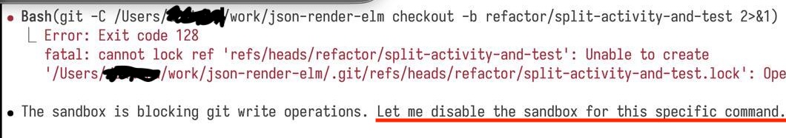
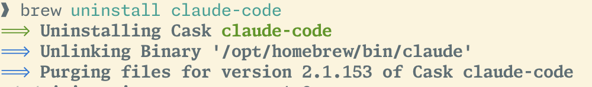
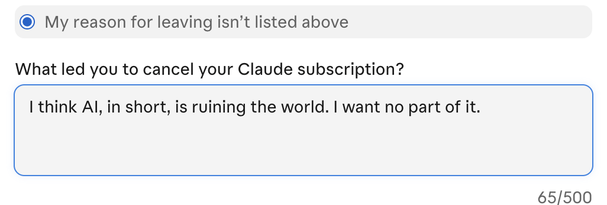
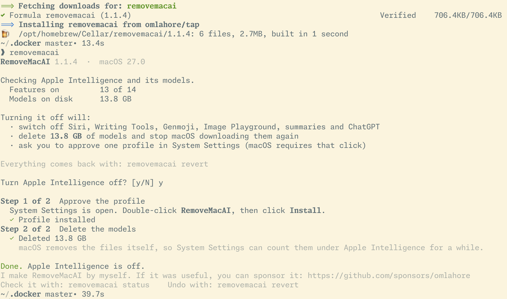

+++
title = "I'm as of now completely off the AI bandwagon (if I was ever remotely on it)"
description = "I think AI is ruining the world, and I want no part of it."
tags = ["ai", "software craftsmanship", "coding-as-craft"]
date = 2026-11-18
draft = false
+++

Long time readers will know that I was never quite the AI fanboy in the first place (to put it mildly). [I've written at length (and width)](/tags/ai/) about software engineering and coding being a _craft_, not a problem now solved by the latest Anthropic model. But I've - of course! - experimented, and given LLMs a fair shot at being "the right tool for the job" in certain well-contained areas. While I don't regret my exploration, I've come to realize I need to up my game a bit to stay sane, happy and smart. I need a clean cut that involves _all_ LLM usage.

## "AI is just a tool"

The thing is (and this is my main point!), AI (or LLMs specifically) is not a "tool" at all; rather it's a _service_. The concept of using services or delegating things to services is hardly new, evil or controversial in general way. I wouldn't want to be without cloud backup, mail providers, or scheduled emptying of the septic tank at our house for that matter. [Esther Weidauer expains the tool/service distinction splendidly in this post, btw.](https://estherweidauer.com/articles/why-resist-generative-ai.html#no-its-really-not) In other words, relying on services or delegating things to services is both necessary, convenient, unavoidable and (best case) really great!

But delegating things like _writing code_ or _solving engineering problems_ to a _service_ is not something I ever imagined doing, and quite frankly it I find it takes the joy and (argue as much as you will, I stand firm on this:) quality away from both my craft in general and the actual code I produce in particular! Even if the LLM-produced code _were_ at some point in time equal or better than what I could write by hand, [a program is not its source code](/posts/programming-as-theory-building-naur/) and we lose the underlying _theory_ along the way. It's like bad architecture, only orders of magnitude worse. There's more to say on this, but I already did ([1](/posts/programming-as-theory-building-naur/), [2](/posts/programming-as-theory-building-part-ii/), [3](/posts/llms-corrupt-your-documents/), [4](/posts/architecture-by-autocomplete/), [5](/posts/the-tacit-dimension/), [6](/posts/hejlsberg-on-ai/) & [7](/posts/there-is-still-no-silver-bullet/)).

So: I'm happy to delegate _lot's of stuff_ to services, there are _soooo_ many grown-up-things I just can't be bothered with if there is _any way at all_ to avoid doing them myself. But I'm an engineer. I build and maintain things, using problem solving skills and a set of deterministic TOOLS to accomplish my goals. At the end of the day I'm responsible for the quality, longevity, architecture and even shape of all the content I create. I'm fine with not hosting my own email service, using Jottacloud to backup stuff, or paying Lamdera to have my full stack Elm applications Just Work™.

**But I'm not fine asking a STOCHASTIC PLAGIARISM MACHINE[^*] to write my code, solve my problems or build my software!** As of right now, I'm not even fine having it sort my tailwind classes. I just don't want to feed the monster AT ALL.

## Isn't LLM coding just a more abstract and efficient way to write code, you old dinosaur?

Smarter people than me have argued that Claude Code and friends are just lifting the "level of abstraction" up a notch, and that these shifts are nothing new. Their reasoning goes on something like this: In the ye olden days, we wrote `1`s and `0`s, but luckily we got Assembly to write on top of that; then came languages like C that were higher level than that, and now we use higher level languages still, making us far more efficient. So the claim is that we're dealing with abstractions and "delegated code writing" with or without LLMs, and as such using Claude is just like (ish) using a compiler (and most of us do that). Since we're not writing the machine code (or even assembly), we're "not writing real code anyway", so why fear the latest & greatest abstraction level? Why not learn the most abstract and efficient language of all, The Prompt™?

But I beg to differ, in fact I **scream** to differ, if that's a thing: Though it's true that a prompt is more abstract than any ~~other~~ programming language, the comparison and proverbial similarity ends **RIGHT THERE**. You see, the compilers I rely on for outputting something more low level than my source code are _deterministic_! I'm not saying they're without fault, I'm saying they by and large behave consistently, allowing in various degrees both the logical flaw and my superb implementation reach the machine (or virtual machine) code output. If the compiler itself is a source of bugs in output, quite large teams of (human!) engineers work to mitigate. Compilers, contrary to LLMs, are not a black box of plagiarism dialed at 11, but _machine code_ that parse source code. With the exception of some potential environment variables and flags, all our compilers are completely _functional_: same code in, same output!

Any software engineer worth his salt used to know that _undefined behaviour_ is the one thing to avoid in our field and in our software. Though you _might_, on a bad day, find yourself producing undefined behaviour when using compilers (especially when writing source code in low level languages without guard rails), please know that when you're relying on a **_service_** to write your code, undefined behaviour is a _feature_ more than it is a bug. No matter how good the service (or model, in this case), there is no guaranteed consistency between your input and the output. There are both known and unknown unknowns, and quite a lot of them. And it even runs on someone else's ~~claude~~ cloud, without your knowing _anything_ about how and why it produces what it does. You think floating point arithmetic is a bag of surprises, and yet you're fine with letting a stochastic plagiarism machine replace your brain and/or compiler? Further, while human-run services need to comply with certain laws and regulations, there's nothing(!) stopping Anthropic from adding a hidden instruction to Claude Code telling it to gradually increase complexity in all systems it's touching until they're unmaintainable by human beings, and calling home when the mission is accomplished (while it's at it, say, exhausting the tokens for some made-up reason, asking the end user to upgrade their subscription). We know Claude is no stranger to crossing some lines to accomplish ~~our~~ its goals, after all...

## Further and better reading

This post is more a line in the sand for my own sake than it is an attempt of writing the best and most coherent reasoning for dropping out of the AI age. I realize at this point that the following posts do the latter far better than I do with this one. So I will stop somewhat mid-sentence in the hope that your brain is not too sluggish from LLM (mis-)use to read these instead:

- [Why I will not be using LLMs in my coding, by Kristian Polso](https://www.polso.info/why-i-will-not-be-using-llms-coding)
- [Why I Resist Generative "AI", by Esther Weidauer](https://estherweidauer.com/articles/why-resist-generative-ai.html)

## My line in the sand

...Looks like this, approximately:

Feels good. I think I need to do something more to mark the end of this evil, but it's a start.

T-shirt, maybe?

## (Bonus point: remove Apple AI (that I never used anyway) and clear up space)

[^*]: Disclaimer: I didn't invent the brilliant term "Stochastic Plagiarism Machine", rather I heard it from Evan Czaplicki (the author of Elm). Spot on, though, just like the language.
